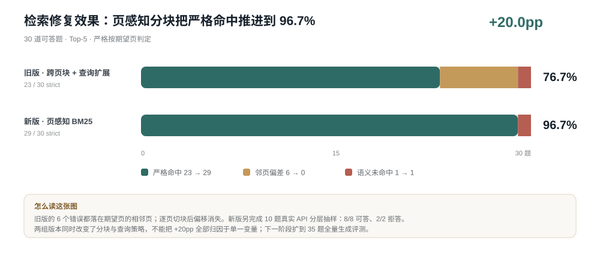
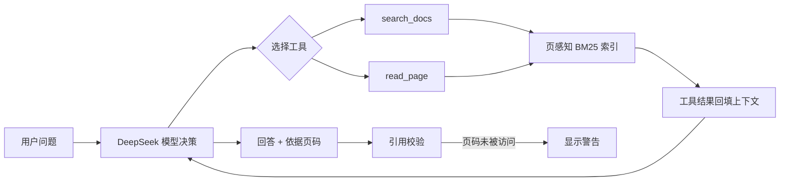

# Course Materials Q&A Assistant

课程资料智能问答助手（RAG → Agent）。把课程 PDF 变成可检索、可溯源、可评测的问答系统。项目从 BM25 RAG 基线推进到 Function Calling 单 Agent 循环，包含页感知检索、两个工具、引用校验和离线测试。

GitHub: [Galaxy15965/aigc-practice](https://github.com/Galaxy15965/aigc-practice)



## 当前状态

- ✅ 页感知 PDF 解析与分块：每个块只属于一个物理页，减少跨页引用偏移
- ✅ BM25 Top-K 检索与 `search_docs` / `read_page` 工具协议
- ✅ 单 Agent 工具循环：模型决策 → 调用工具 → 观察结果 → 生成回答
- ✅ 引用页码校验：回答引用了未访问页面时给出警告
- ✅ Streamlit Agent 界面与工具轨迹回放
- ✅ 13 个离线单元测试，使用模拟模型验证工具调用闭环
- ✅ DeepSeek 真实 API 冒烟：3 题全部通过，9 次工具调用，无答案题拒答 1/1
- ⏳ 35 题全量真实 API 评测、Memory、浏览器验证和多 Agent 协同尚未完成

## 功能

- PDF 解析与逐页分块（约 300 字符/块，最短 50 字）
- BM25 关键词检索，返回 Top-5 原文片段、页码和分数
- Agent 根据问题选择 `search_docs` 或 `read_page`
- 工具调用参数校验、重复调用拦截和异常返回
- 回答只依据检索资料，无依据时明确拒答
- 回答末尾输出依据页码，并核对页码是否真的被工具访问
- Streamlit 页面展示答案、工具轨迹、耗时和检索分数

## 架构



## 评测

同一套 35 题评测集（30 道可答 + 5 道应拒答）：

| 版本 | 分块与检索 | 严格 Hit@5 | 说明 |
|---|---|---:|---|
| 旧版 | 跨页块 + BM25 + 查询扩展 | 23 / 30 = 76.7% | 6 个错误落在期望页的相邻页 |
| 新版 | 页感知块 + BM25 | **29 / 30 = 96.7%** | 邻页偏差消失，仅剩 1 个语义未命中 |

> 新版完成离线检索评测与 3 题真实 API 冒烟；35 题全量生成评测尚未跑。旧版生成链路的无答案拒答正确率为 5 / 5。两版同时改变了分块与查询策略，不能把提升全部归因于单一变量。

### DeepSeek 真实 API 冒烟（3 题）

| 题目 | 结果 | 工具调用 | 耗时 |
|---|---|---:|---:|
| 调查报告的写作一般要经历哪三个阶段？ | 命中第 11 页 | 2 | 2.65s |
| 调查报告的“实”具体指哪三个方面？ | 查询改写 + `read_page(45)`，命中第 45 页 | 3 | 3.92s |
| 如何用 PyTorch 训练一个 CNN？ | 正确拒答 | 4 | 3.96s |

合计 8 次 API 请求、9 次工具调用、13,844 tokens。3 题均主动调用 `search_docs`；第 2 题额外调用 `read_page`；无答案题拒答 1/1。该结果是小样本冒烟，不等同于 35 题全量评测。

运行离线评测与测试：

```bash
python -m unittest discover -s tests -v
```

## 快速开始

```bash
python -m venv .venv
.venv\Scripts\activate
pip install -r requirements.txt
```

将课程 PDF 放入 `data/`，默认读取 `data/xiezuo1.pdf`。在 `config.py` 中填入 DeepSeek API Key：

```python
API_KEY = "你的 API Key"
```

启动 Agent 界面：

```bash
streamlit run agent_app.py
```

命令行单次提问：

```bash
python agent.py "调查报告的写作一般要经历哪几个阶段？" --verbose
```

## 工具协议

### `search_docs`

```json
{
  "query": "调查报告的写作阶段",
  "top_k": 5,
  "max_chars": 1200
}
```

返回相关片段、页码、BM25 分数和最佳分数。没有词项重叠时返回空结果，不强行拼接无关内容。

### `read_page`

```json
{
  "page_no": 11,
  "max_chars": 6000
}
```

读取指定物理页原文，用于核对上下文和引用。

## 项目结构

```text
agent.py            单 Agent 工具调用循环与 CLI
agent_app.py        Streamlit Agent 界面
retrieval.py        页感知 PDF 分块、BM25 索引与检索
tools.py            Function Calling 工具 schema 与执行器
chunking.py         原有段落分块逻辑
app.py              原 RAG 问答界面
eval.py             旧版 35 题评测脚本
tests/              离线单元测试
data/               课程 PDF（不提交）
```

## 已知问题

- 扫描页或图片页没有文字层，当前无法检索
- BM25 只做关键词匹配，近义改写和语义检索能力有限
- Agent 回答仍依赖模型遵循 System Prompt，不能保证每次主动调用工具
- 引用校验只能发现“引用了未访问页码”，不能证明页码对应内容完全正确
- 真实 API 仅做 3 题冒烟，样本量小，不能代表整体成功率
- 引用校验只能识别“第 X 页”或“第 X—Y 页”格式，逗号分隔的多页码尚未覆盖

## 下一步

1. 用真实 DeepSeek API 重跑 35 题，记录工具调用成功率、引用正确率和成本
2. 加入滚动摘要、上下文预算和任务状态，支持多轮长任务
3. 增加 Python 执行、浏览器截图与 DOM 检查工具
4. 将评测扩展到 40 条任务，覆盖检索、文件、网页和多步执行

## 技术栈

Python 3.14 · Streamlit · pypdf · jieba · rank-bm25 · DeepSeek API

课程 PDF 和 API Key 不进入版本库。
