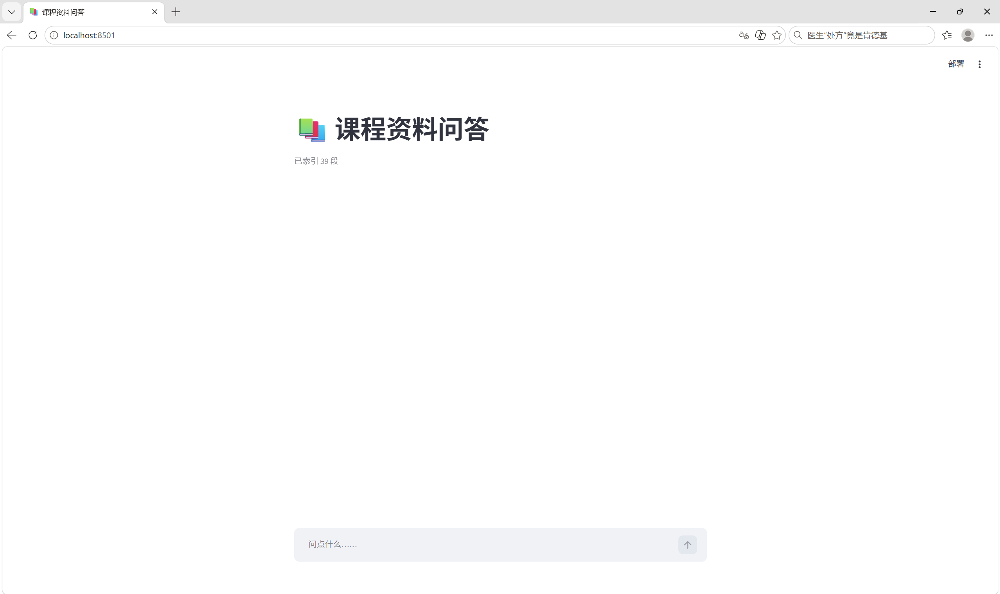

# 课程资料智能问答助手(RAG)

把教材/实验指导书 PDF 放入 `data/`,用自然语言提问,答案会标注来源页码。



## 功能

- PDF 解析与按段落分块(300 字符/块),每块保留页码标记,答案可溯源
- BM25 关键词检索,返回 Top-5 相关段落
- 查询扩展:原问题改写成 3 个变体,合并检索结果
- 基于检索结果生成答案,资料外问题主动拒答
- 35 条评估集(30 条可答 + 5 条应拒答),自动计算 Hit@5 与拒答率

## 技术栈

Python 3.14 · Streamlit · pypdf · jieba · rank_bm25 · DeepSeek API

## 快速开始

```bash
git clone https://github.com/Galaxy15965/aigc-practice.git
cd aigc-practice
python -m venv .venv
.venv\Scripts\activate
pip install -r requirements.txt